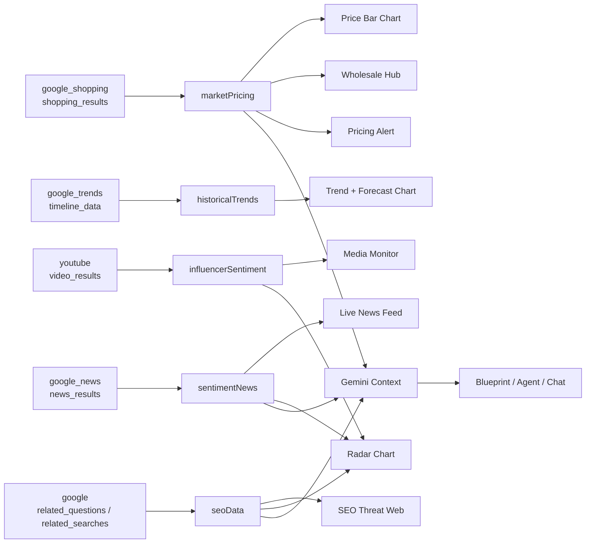
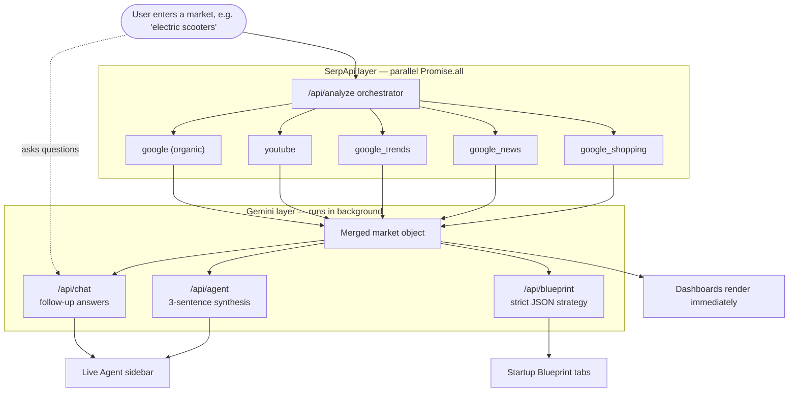

<div align="center">


# 🛡️ OMNISIGHT

**Autonomous market intelligence: 5 SerpApi engines + Google Gemini, one search box.**

<br/>

<a href="https://drive.google.com/file/d/1VGOljxomqAJaTvBPez9y88Hh0OBGq8T8/view?usp=sharing" target="_blank">
  
</a>

<br/><br/>

Type a product or market. OmniSight queries five SerpApi engines in parallel, builds charts and an SEO graph from the results, and has Gemini write a startup blueprint you can question in a live chat.

</div>

---

## 📑 Contents

- [Why OmniSight](#-why-omnisight)
- [SerpApi: The Data Backbone (Deep Dive)](#-serpapi-the-data-backbone-deep-dive)
  - [What SerpApi does for us](#what-serpapi-does-for-us)
  - [SDK and setup](#sdk-and-setup)
  - [Engine 1 — Google Shopping](#engine-1--google-shopping)
  - [Engine 2 — Google News](#engine-2--google-news)
  - [Engine 3 — Google Trends](#engine-3--google-trends)
  - [Engine 4 — YouTube](#engine-4--youtube)
  - [Engine 5 — Google Organic Search](#engine-5--google-organic-search)
  - [Parallel orchestration](#parallel-orchestration)
  - [Failure isolation](#failure-isolation)
  - [From SerpApi JSON to the UI](#from-serpapi-json-to-the-ui)
  - [Credit usage](#credit-usage)
- [Gemini AI Layer](#-gemini-ai-layer)
- [Agentic Workflow Diagram](#-agentic-workflow-diagram)
- [Features by Tab](#-features-by-tab)
- [Architecture & Project Structure](#-architecture--project-structure)
- [API Reference](#-api-reference)
- [Live vs. Estimated Data](#-live-vs-estimated-data)
- [Setup](#-setup)
- [Documentation](#-documentation)

---

## 💡 Why OmniSight

Checking whether a market is worth entering usually means opening Google Trends, Google Shopping, Google Search, Google News, and YouTube in separate tabs, then trying to combine what you see by hand.

OmniSight does all five lookups in one request through **SerpApi**, puts the results on one screen, and uses **Gemini** to turn them into a plan.

---

## 🌩️ SerpApi: The Data Backbone (Deep Dive)

**Every live number, headline, video, question, and price in OmniSight comes from SerpApi.** Without it, this project would need five separate scrapers, proxy rotation, CAPTCHA handling, and HTML parsers that break whenever Google changes its layout.

### What SerpApi does for us

| Without SerpApi | With SerpApi |
|---|---|
| Write and maintain an HTML scraper per engine | One `getJson()` call per engine |
| Rotate proxies, handle blocks and CAPTCHAs | Handled by SerpApi |
| Parse changing page layouts | Stable JSON keys (`shopping_results`, `news_results`, …) |
| Different formats per source | Same request/response pattern for all 5 engines |

### SDK and setup

OmniSight uses the official [`serpapi`](https://www.npmjs.com/package/serpapi) Node package. All engine calls live in **[`src/lib/serpapi.ts`](src/lib/serpapi.ts)**.

```ts
import { getJson } from "serpapi";
const API_KEY = process.env.SERPAPI_API_KEY; // server-side only
```

The key is only read inside Next.js server routes, so it never reaches the browser.

---

### Engine 1 — Google Shopping

**Question it answers:** *What does this product sell for, and who sells it?*

```ts
getJson({ engine: "google_shopping", q: query, hl: "en", gl: "us", api_key })
```

| Parameter | Value | Meaning |
|---|---|---|
| `engine` | `google_shopping` | Google Shopping results |
| `q` | user query | Product search term |
| `hl` | `en` | Interface language |
| `gl` | `us` | Country for prices and retailers |

**Response fields used:** `shopping_results[]` → `title`, `source`, `price`, `link`, `thumbnail`
**Kept:** first 15 results → `marketPricing`

**Where it shows up:**
- **Retail Price bar chart** — price per retailer (price strings like `"$1,299.00"` are parsed to numbers).
- **Retail ceiling / floor / average** — max, min, and mean of live prices.
- **Pricing Alert** in the chat — *"Retail ceiling is $X. Target $Y bulk."*
- **B2B Wholesale Hub** — one card per retailer with the live retail price.
- **Gemini context** — top 3–4 prices are sent to the AI routes.

---

### Engine 2 — Google News

**Question it answers:** *Is anything happening right now that affects this market?*

```ts
getJson({ engine: "google_news", q: query, gl: "us", api_key })
```

**Response fields used:** `news_results[]` → `title`, `source.name`, `link`, `date`
**Kept:** first 8 → `sentimentNews`

**Where it shows up:**
- **Live Data Feed** message in the chat (example from a real run: *"More than 42,000 trimmer mowers recalled over fire hazard" — FOX 13 Seattle*).
- **News Hype** axis on the radar chart.
- **Gemini context** — top headlines let the AI react to recalls, bans, or launches.

---

### Engine 3 — Google Trends

**Question it answers:** *Is interest growing, flat, or fading?*

```ts
getJson({ engine: "google_trends", q: query, data_type: "TIMESERIES", date: "all", api_key })
```

| Parameter | Value | Meaning |
|---|---|---|
| `data_type` | `TIMESERIES` | Interest over time |
| `date` | `all` | Full history, 2004 to today |

**Response fields used:** `interest_over_time.timeline_data[]` → `date`, `values[0].extracted_value` (0–100)
**Kept:** full timeline → `historicalTrends`

**Where it shows up:**
- **Historical + Forecast area chart.** OmniSight samples every 6th point, then extends the line 18 months forward using the average change of the last five samples, so you can see where the trend is heading.

---

### Engine 4 — YouTube

**Question it answers:** *What are reviewers and creators saying?*

```ts
getJson({ engine: "youtube", search_query: query, api_key })
```

> Note: the YouTube engine uses `search_query`, not `q`.

**Response fields used:** `video_results[]` → `title`, `link`, `channel`, `views`, `published_date`
**Kept:** first 6 → `influencerSentiment`

**Where it shows up:**
- **Media Monitor tab** — real embedded YouTube players (the video ID is taken from the `v=` part of each `link`).
- **Video Reach** axis on the radar chart.

---

### Engine 5 — Google Organic Search

**Question it answers:** *What are people actually asking and searching for?*

```ts
getJson({ engine: "google", q: query, api_key })
```

**Response fields used:**

| Field | Google feature | Kept as |
|---|---|---|
| `related_questions[].question` | "People Also Ask" | `seoData.questions` |
| `related_searches[].query` | "Related searches" | `seoData.searches` |
| `organic_results[]` (top 5) | Ranking pages | `seoData.rankings` |

**Where it shows up:**
- **SEO Threat Web** — an interactive React Flow graph: the query in the centre, up to 4 "People Also Ask" questions on the left, up to 4 related searches on the right.
- **Demand** axis on the radar chart.
- **Gemini context** — the top 5 questions drive the "Market Gap" and "The Why" sections of the blueprint.

---

### Parallel orchestration

[`src/app/api/analyze/route.ts`](src/app/api/analyze/route.ts) fires all five engines at the same time:

```ts
const [shoppingData, newsData, trendsData, youtubeData, organicData] = await Promise.all([
  searchGoogleShopping(query),
  searchNews(query),
  searchGoogleTrends(query),
  searchYouTube(query),
  searchGoogleOrganic(query)
]);
```

The response time is roughly the time of the **slowest single engine**, not all five added together.

### Failure isolation

Each engine function has its own `try/catch` and returns `null` on failure. The route then defaults every field to an empty array:

```ts
const newsResults = newsData?.news_results || [];
```

If one engine fails, the other four still render.

### From SerpApi JSON to the UI



### Credit usage

| Action | SerpApi searches used |
|---|---|
| Click **Execute** | **5** (one per engine) |
| Blueprint generation | 0 (reuses fetched data) |
| Agent synthesis | 0 |
| Each chat message | 0 |

---

## 🧠 Gemini AI Layer

After SerpApi returns, the browser sends the combined data to three Gemini-backed routes (model: `gemini-1.5-flash`):

| Route | What Gemini receives | What it returns |
|---|---|---|
| [`/api/agent`](src/app/api/agent/route.ts) | Top prices, headlines, questions | A 3-sentence market recommendation (shown as **Agent Synthesis** in chat) |
| [`/api/blueprint`](src/app/api/blueprint/route.ts) | Top prices, headlines, questions + a strict JSON schema | A full startup blueprint as JSON (opportunity, problem, solution, gaps, recommendation, detailed analysis, 3-phase roadmap) |
| [`/api/chat`](src/app/api/chat/route.ts) | The user's question + live prices and headlines | A short answer grounded in the current search |

**Fallbacks:** if the Gemini key is missing, invalid, or rate-limited, each route returns a ready-made response with HTTP 200, so the interface never hangs.

---

## 🤖 Agentic Workflow Diagram



---

## 🖥️ Features by Tab

| Tab | What you see | Data source |
|---|---|---|
| **Market Dashboard** | Trend + forecast area chart, retail price bar chart, market threat radar, live AI chat sidebar | Trends, Shopping, News, YouTube, Organic, Gemini |
| **SEO Threat Web** | Interactive node graph of questions and related searches; click a node for details | Organic (`related_questions`, `related_searches`) |
| **Media Monitor** | Embedded YouTube review videos and news | YouTube, News |
| **B2B Wholesale Hub** | Retailer cards with live retail price and estimated bulk price | Shopping |
| **Startup Blueprint** | Executive Summary · Market Gap Analysis · Visual Roadmap, plus "View detailed analysis" | Gemini (from SerpApi data) |
| **Export Report** | Compiles & downloads a multi-page Executive Market Report for the browsed product via `/api/export-report`, with browser print preview | Dynamic (Puppeteer + SerpApi + Gemini) |
| **API Access / Settings** | Demo API card; region and language selectors | UI only |

---

## 🏗️ Architecture & Project Structure

```
supply-chain-sleuth/
├── src/
│   ├── lib/serpapi.ts             # 5 SerpApi engine functions
│   └── app/
│       ├── page.tsx               # Full client UI: tabs, charts, chat, modals
│       ├── layout.tsx             # Root layout
│       ├── globals.css            # Tailwind + global styles
│       └── api/
│           ├── analyze/route.ts   # Runs the 5 engines in parallel
│           ├── agent/route.ts     # Gemini synthesis
│           ├── blueprint/route.ts # Gemini JSON blueprint
│           └── chat/route.ts      # Gemini chat
├── public/OmniSight_Hackathon_Report.pdf
└── docs/                          # Report and pitch deck (MD, PDF, PPTX)
```

| Layer | Tech |
|---|---|
| Framework | Next.js 16 (App Router), React 19, TypeScript |
| Styling | Tailwind CSS 4 (dark theme) |
| Charts | Recharts 3 (Area, Bar, Radar, Pie) |
| Graph | @xyflow/react (React Flow 12) |
| Search data | SerpApi Node SDK (`serpapi`) |
| AI | Google Gemini REST API |

---

## 🔌 API Reference

| Endpoint | Body | Returns |
|---|---|---|
| `POST /api/analyze` | `{ "query": "trimmers" }` | `{ query, marketPricing, sentimentNews, historicalTrends, influencerSentiment, seoData }` |
| `POST /api/agent` | `{ "query", "serpData" }` | `{ "response": "..." }` |
| `POST /api/blueprint` | `{ "query", "serpData" }` | `{ opportunityTitle, opportunityText, problemText, solutionText, goingWell[], needsAttention[], theWhy[], recommendation, detailedAnalysis, phase1[], phase2[], phase3[] }` |
| `POST /api/chat` | `{ "message", "serpData" }` | `{ "response": "..." }` |
| `POST /api/export-report` | `{ "query", "results", "aiBlueprint", "avgRetailPrice", "estWholesalePrice", "minPrice", "maxPrice" }` | Binary PDF stream (`application/pdf`) |

---

## 🔍 Live vs. Estimated Data

**Live from SerpApi on every search:** retail prices and retailers, news headlines, the Google Trends timeline, YouTube videos, "People Also Ask" questions, related searches, and organic rankings.

**Estimated or illustrative (clearly not live):**
- Wholesale price = 35% of average retail price.
- SEO node volume / CPC / difficulty are calculated from the keyword length for display.
- Supplier emails in the Wholesale Hub are generated from the retailer name.
- Market channel pie chart and the Margins / Competition radar axes use fixed values.
- The forecast is a simple straight-line projection.

---

## ⚙️ Setup

```bash
git clone https://github.com/shrikargs7-cloud/OmniSight.git
cd OmniSight
npm install
```

Create `.env.local`:

```env
SERPAPI_API_KEY=your_serpapi_key
GEMINI_API_KEY=your_gemini_key   # Google AI Studio keys usually start with "AIza"
```

Run:

```bash
npm run dev      # http://localhost:3000
```

---

## 📚 Documentation

| File | Description |
|---|---|
| [**Demo Video Walkthrough**](https://drive.google.com/file/d/1VGOljxomqAJaTvBPez9y88Hh0OBGq8T8/view?usp=sharing) | Live product walkthrough & presentation video on Google Drive |
| [`docs/OmniSight_Hackathon_Report.pdf`](docs/OmniSight_Hackathon_Report.pdf) | Full project documentation: every file, function, state variable, data schema, and formula |
| [`docs/OmniSight_Pitch_Deck.pptx`](docs/OmniSight_Pitch_Deck.pptx) | 10-slide pitch deck with speaker notes |

---

<div align="center"><i>Built for the SerpApi India Hackathon 2026.</i></div>
